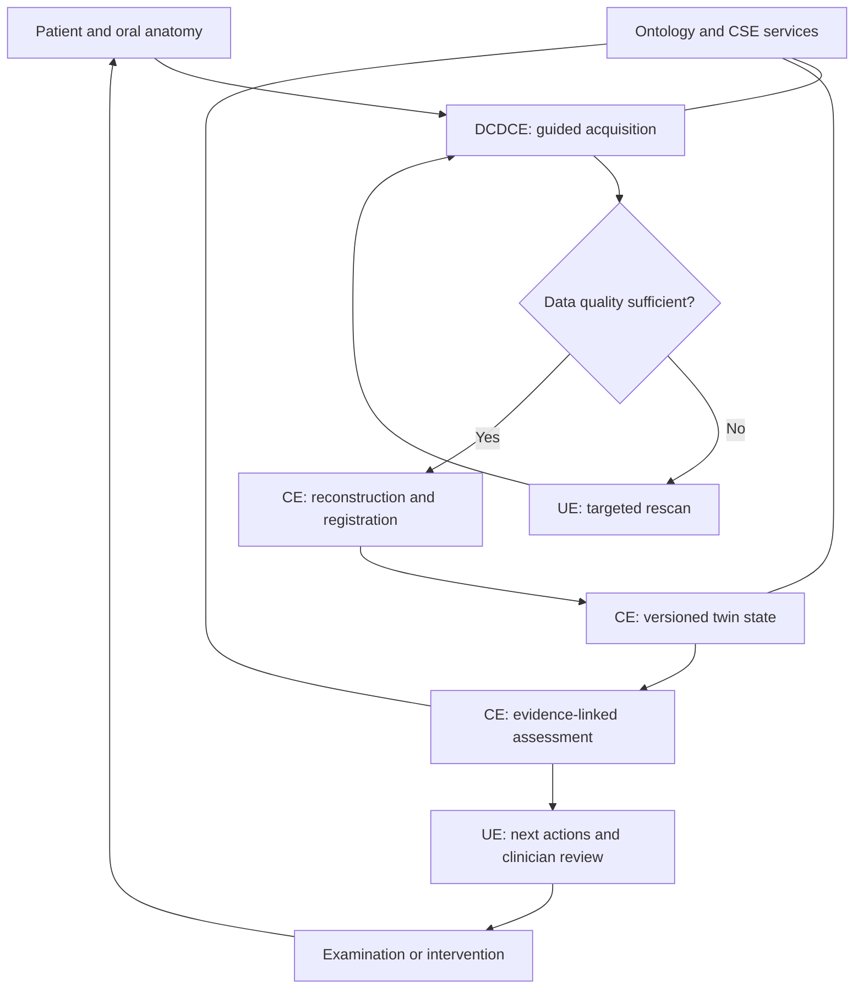

# Dental DT Architecture v0.1

Status: discussion draft, 2026-10-12. Goal: comprehensive visible oral/tooth acquisition, longitudinal twin updates, evidence-linked assessment and next-action support. Not an implemented or clinically validated product. Reference architecture adapted from ISO 23247; formal conformity remains unassessed.

## Entity view

| Entity | DDT components | Responsibility |
|---|---|---|
| OME/context | Eight manufacturing categories and explicit patient/anatomy extension | Physical objects and observable activities |
| DCDCE | Scanner firmware, session manager, acquisition adapter, synchronization | Acquire RGB, geometry and optional NIR; collect quality/provenance; transfer observations |
| CE | Twin registry, versioned state store, reconstruction, registration, analysis and assessment services | Maintain digital representation, calculate changes and evidence-linked assessments |
| UE | Patient guided scanning and clinician review applications | Rescan instructions, visualization, interpretation review and action tracking |
| CSE | Identity, authorization, semantic translation, units, quality assurance and audit | Common functions across components |

Core grouping follows operation/management, applications/services and resource access/interchange. Cross-system functions are not a sequential pipeline stage. Patient/anatomy are project clinical extensions, not ISO manufacturing products.

## Eight OME categories

Personnel: dentists/technicians/operators; Equipment: scanners/sensors/calibration tools; Material: appliance and restoration materials; Process: scanning/examination/follow-up; Facility: clinic/laboratory; Environment: acquisition environment; Product: fabricated scanner, mouthpiece or restoration where appropriate; Supporting document: protocols/instructions/calibration records.

The OME list defines possible scope. Not every category needs a twin in the first prototype.

## Functional flow

This diagram is a project design, not an ISO diagram. Quality acceptance criteria are use-case-specific and not yet implemented. Partial accepted regions may be retained with explicit missing-data annotations; never fill gaps silently with predicted healthy anatomy.

## Acquisition modules

| Module | Data | Status |
|---|---|---|
| RGB | Colour images and frame metadata | Proposed core |
| Geometry optics | Point clouds/meshes and calibration | Proposed core; optical mechanism undecided |
| NIR | Tooth optical contrast | Optional candidate; separate validation required |
| Supplemental sensing | pH, periodontal probing, EMG or other modalities | Future use-case-dependent inputs |

Optical surface acquisition does not provide pocket depth, pulp perfusion or bone state. Self-scan completeness and repeatability must be demonstrated. A professional baseline may support home follow-up, but that approach does not prove independent full-arch measurement accuracy.

## CE services and storage

- Registry: stable patient, tooth, surface, device and twin identifiers.
- Acquisition ingestion: immutable source artifacts, session and calibration metadata.
- Reconstruction/registration: model version, transform, uncertainty, visible/missing coverage.
- State: chronological immutable snapshots; latest is a view, not overwriting evidence.
- Analysis: separate measured properties from derived features and condition hypotheses.
- Assessment: use-case-specific rules/models with supporting evidence; no implemented disease rules in v0.1.
- Actions: repeat scan, clinician review, additional examination and, after review, treatment planning.

Store images/meshes in an artifact store; semantic links and metadata in RDF; operational records in a relational store if needed. Time-series storage is optional. These are logical choices, not selected products.

## Clinical output contract

Return anatomical scope, evidence references, data quality, uncertainty description, model/protocol version, review status and proposed next action. A Finding is not a ClinicianDiagnosis. A Recommendation is not a TreatmentPlan. Diagnosis requires recorded clinician review; recommendations can remain unreviewed and clearly labelled.

No automated device actuation or autonomous treatment execution is included. Model-confidence calibration and escalation policies remain to be designed.

## Ontology integration

See [core ontology](../ontology/ddt-core.ttl), [SHACL shapes](../ontology/ddt-shapes.ttl) and [synthetic example](../ontology/examples/synthetic-scan.ttl). Class references reuse SOSA, PROV-O and OWL-Time vocabulary. Proposed DDT namespace is not registered. External ontologies are not downloaded automatically; no external OWL imports are declared.

## Initial validation plan

Validate graph syntax/constraints now. Later measure novice acquisition completion, per-surface coverage, geometric trueness/precision, repeated-scan registration error, change detection and clinical assessment performance against explicit reference standards. Ontology validation is not clinical model validation.
